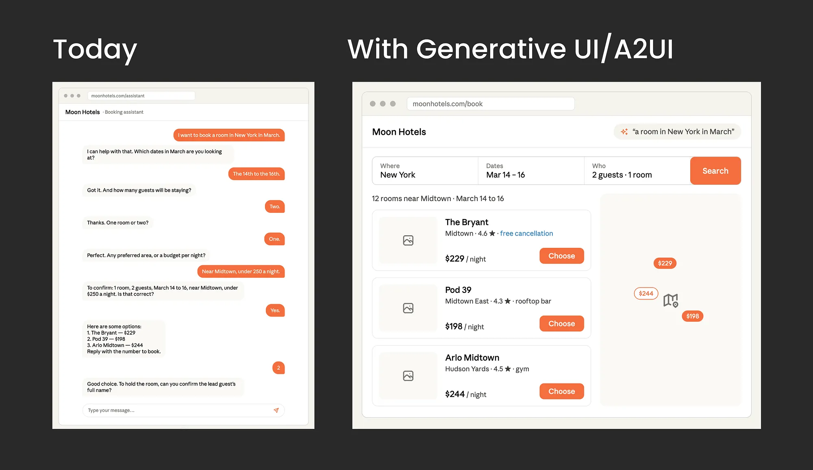
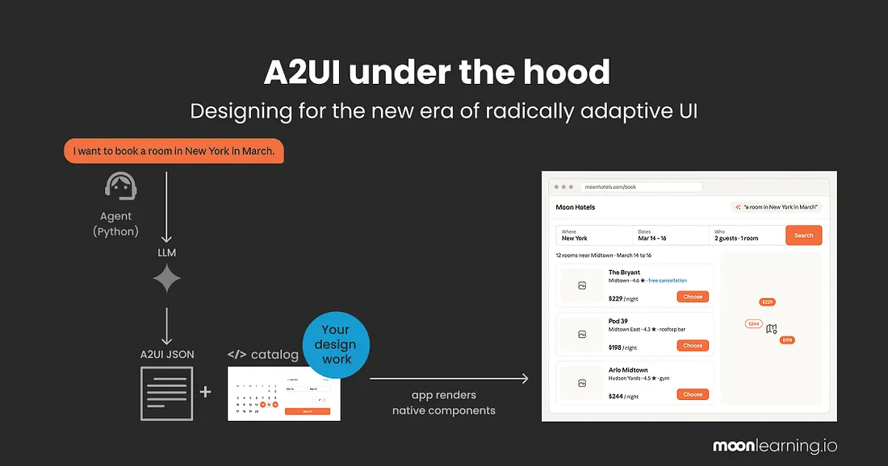
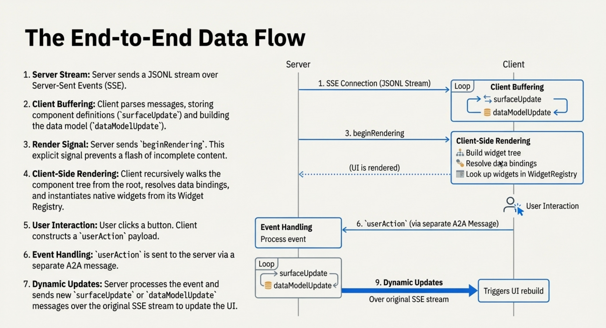
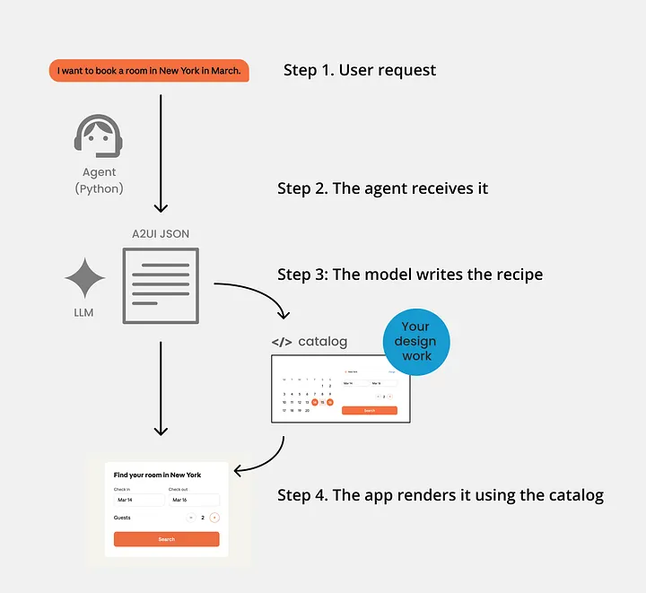
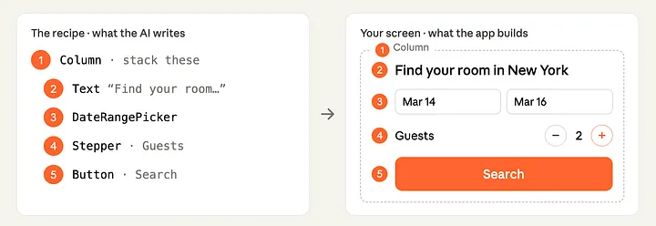
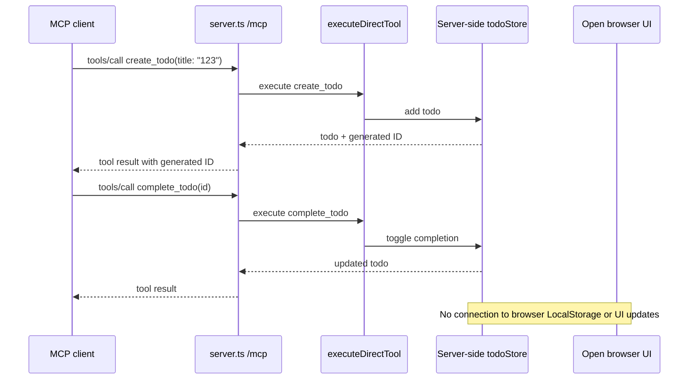
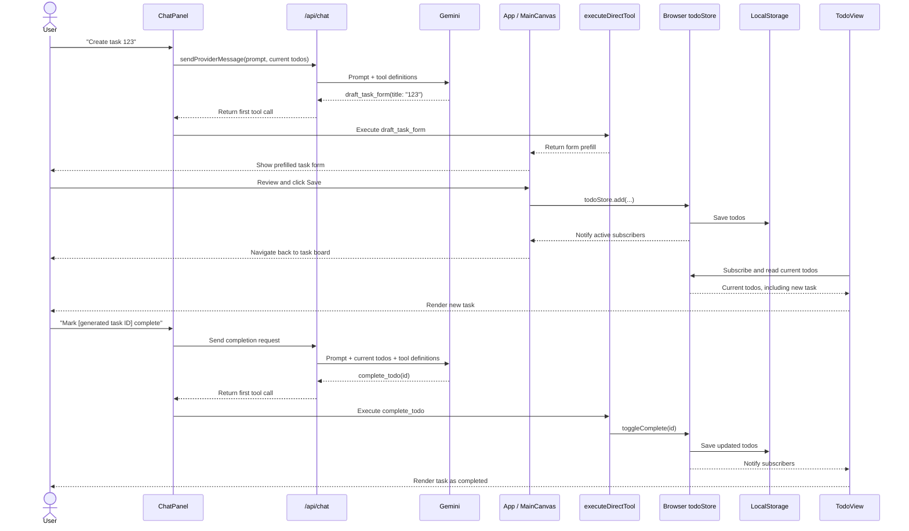
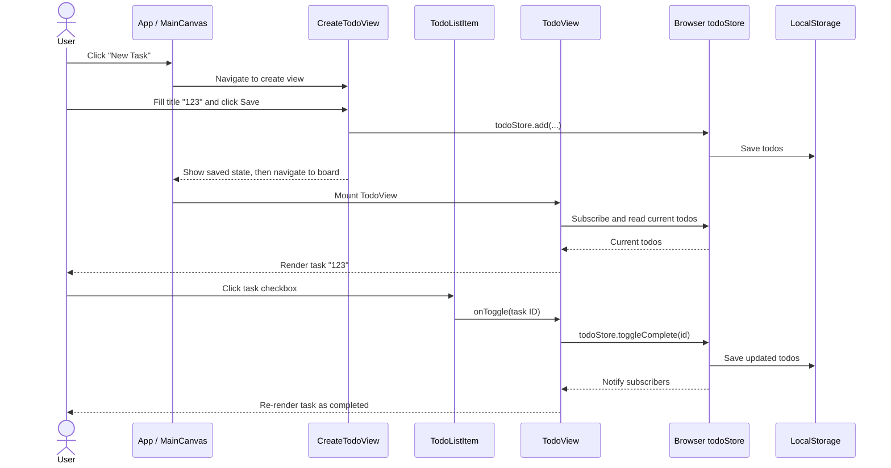

# Beyond AI Chatbots: Building Agent-Driven Applications with MCP, WebMCP and A2UI

## 🌐 The web is not just for humans anymore!

<!-- fragment -->
> The internet was originally built for humans. We designed buttons, dropdowns, and forms for people to read, understand, and use.
But now there’s a new type of user emerging: **`AI agents` 🤖.** Soon they’ll be able to complete registrations, buy tickets, and take any action needed to complete a goal on a website.

<!-- fragment -->
> They must crawl websites and reverse-engineer how everything works.
For example, to book a flight, an agent needs to identify the right input fields, guess the correct data format, and hope nothing breaks in the process. It’s inefficient. ⏳

<!-- fragment -->

## 🤔 What can we do about this?

<!-- fragment -->
> We can use the **MCPs** standard which will solve this issue by exposing the structure of these tools so AI agents can understand and perform better. 🚀

> We can use the **Generative UIs** standard which will solve this issue by exposing UI components so AI agents can understand and perform better. 🚀


---

# 👋 WHOAMI

<!-- columns: 2 -->

**Just a guy figuring things out and not afraid to show my mess or my beautiful solutions. 💡**

**My name is Alex Muturi 👨‍💻**

You can find me on:
- 🐦 Twitter / X: [@MuturiAlex](https://x.com/MuturiAlex)
- 💼 LinkedIn: [Alex Muturi](https://linkedin.com/in/alex-muturi)
- 🌐 Blog: [alex-migwi.github.io](https://alex-migwi.github.io)
- 🐙 GitHub: [alex-migwi](https://github.com/alex-migwi)
- 📝 Medium: [alex-migwi.medium.com](https://alex-migwi.medium.com)

**🅰️ I also write Angular stuff on [angularrecipes.dev](https://angularrecipes.dev)**

<!-- col-break -->


> Note: Welcome everyone! Today we're diving into WebMCP—the Web Model Context Protocol—and exploring how it transforms web application testing from brittle UI scripts into self-healing, autonomous AI agent workflows.

---

# What does the future beyond just chat bots look like?

Most AI applications still behave like chatbots: users type a request, the model returns text, and the application does very little with the result.

A new generation of agentic standards is changing that.

MCP allows applications to expose tools and data to agents. WebMCP brings those capabilities into the browser, allowing web applications to register structured actions that agents can discover and invoke. A2UI enables agents to generate rich, interactive interfaces using trusted components rather than generating arbitrary code.

* MCP gives the agent access to backend tools and services.
* WebMCP exposes browser-level application capabilities.
* A2UI allows the agent to generate a contextual interface for the user.
* The host application retains control over components, permissions, validation and execution.

## The new approach: Generative UI or radically adaptive UI

### What if the pre-built persona we usually design for, the made-up average user, quietly changes in this scenario?

<!--fragment -->
> <strong>Generative UI is not only a UI shift but also a huge UX shift.</strong> 

---

# What does Generative-UI or A2UI have to do with all of this?

### In standard apps, human engineers write strict, static code for every view. 

### In an AI-driven world, an application must allow a non-human agent to build user interfaces dynamically on the fly, without compromising system security.

</br>

# Building Blocks
<!-- columns: 3 col -->

## What is A2UI?
* A2UI (Agent-to-User Interface) is an open protocol from Google that enables AI agents to generate rich, interactive user interfaces safely and declaratively. 
* Instead of generating code, agents describe UIs as structured data that clients render natively.

<!-- col-break -->
## What is WebMCP?

* WebMCP (Web Model Context Protocol) is a proposed web standard that allows websites to expose structured tools to AI agents directly within the browser.
* WebMCP enables browsers to expose structured tools to AI agents through the `navigator.modelContext` API. Developers can present their web application functionality as callable "tools," meaning JavaScript functions with natural language descriptions and structured schemas that AI agents, browser assistants, and assistive technologies can invoke directly. No more guese work and DOM scraping.

<!-- col-break -->

## What is MCP?

* MCP (Model Context Protocol) is an open standard introduced by Anthropic in November 2024 that defines how AI applications connect to external tools, data sources, and services.  
* It's often described as the "USB-C for AI" — a universal adapter that replaces fragmented, custom integrations with a single protocol.

---

# The Core Concept

A2UI solves a fundamental challenge: how to safely transmit sophisticated UIs across trust boundaries without executing arbitrary code.

WebMCP and MCP expose structured tools to AI agents. Application functionality becomes callable "tools," meaning functions with natural language descriptions and structured schemas that AI agents, browser assistants, and assistive technologies can invoke directly.

</br></br>

<!-- columns:3 col-->

<svg xmlns="http://www.w3.org/2000/svg" width="32" height="32" viewBox="0 0 24 24" fill="none" stroke="currentColor" stroke-width="1.5" stroke-linecap="round" stroke-linejoin="round" class="lucide lucide-file-json text-[#006699]"><path d="M15 2H6a2 2 0 0 0-2 2v16a2 2 0 0 0 2 2h12a2 2 0 0 0 2-2V7Z"></path><path d="M14 2v4a2 2 0 0 0 2 2h4"></path><path d="M10 12a1 1 0 0 0-1 1v1a1 1 0 0 1-1 1 1 1 0 0 1 1 1v1a1 1 0 0 0 1 1"></path><path d="M14 18a1 1 0 0 0 1-1v-1a1 1 0 0 1 1-1 1 1 0 0 1-1-1v-1a1 1 0 0 0-1-1"></path></svg> 
## Agents Describe

AI agents generate declarative JSON that describes UI structure and data. No code, no framework specifics, just a universal recipe.

<!-- col-break -->
<svg xmlns="http://www.w3.org/2000/svg" width="32" height="32" viewBox="0 0 24 24" fill="none" stroke="currentColor" stroke-width="1.5" stroke-linecap="round" stroke-linejoin="round" class="lucide lucide-layers text-[#006699]"><path d="M12.83 2.18a2 2 0 0 0-1.66 0L2.6 6.08a1 1 0 0 0 0 1.83l8.58 3.91a2 2 0 0 0 1.66 0l8.58-3.9a1 1 0 0 0 0-1.83z"></path><path d="M2 12a1 1 0 0 0 .58.91l8.6 3.91a2 2 0 0 0 1.65 0l8.58-3.9A1 1 0 0 0 22 12"></path><path d="M2 17a1 1 0 0 0 .58.91l8.6 3.91a2 2 0 0 0 1.65 0l8.58-3.9A1 1 0 0 0 22 17"></path></svg>

## Catalogs Define
Pre-approved component catalogs determine what UI elements are available. Clients control the vocabulary, agents work within those bounds.

<!-- col-break -->
<svg xmlns="http://www.w3.org/2000/svg" width="32" height="32" viewBox="0 0 24 24" fill="none" stroke="currentColor" stroke-width="1.5" stroke-linecap="round" stroke-linejoin="round" class="lucide lucide-code text-[#006699]"><polyline points="16 18 22 12 16 6"></polyline><polyline points="8 6 2 12 8 18"></polyline></svg>

## Clients Render
Your app maps abstract components to your design system. "Button" becomes your button, styled your way, with your behavior.

---

# 1. The Core Philosophy: "Recipes, Not Code"

## AI can: call tools/execute code via WebMCP or MCP and also generate code.

### 💡 Why WebMCP and MCP?

`WebMCP` and `MCP` help you:

```text
- 🌉 Bridge the gap between web applications and agents
- ⚡ Improve efficiency
- 🛡️ Improve reliability
- 🎯 Improve task completion

by providing rules for interaction.
```
<!-- fragment -->
```text
- 🧩 Instead of an agent reviewing an element, such as a button or field, to understand its purpose, the website declares the element's purpose so it's used correctly.
- 🧩 Instead of creating an for every `API` a API resource declares tools accessed via `MCP` defining the resource purpose so it's used correctly.
- 🎯 This is more reliable than actuation or gueswork or repeated integrations, which may have numerous steps and leaves each step open to interpretation by the agent.
```
> The `WebMCP` and `MCP` standards provide a way to build and expose structured tools for AI agents. It allows them to understand and interact with web pages more reliably, improving efficiency and task completion. Instead of guessing how elements work, agents can use the provided information to act with confidence. ✨

---

# But with A2UI in addtion to MCP's...

> <strong>the AI never generates or sends code (HTML, CSS, JavaScript) to the client application.</strong>

</br>
<!-- fragment -->

## Why not send code to client app?
If an agent could send raw code, it could execute malicious scripts, hijack data, or destroy the layout (Cross-Site Scripting or XSS vulnerability). 

<!-- fragment -->
## How do we show the UI?
Instead, the AI agent outputs a structured recipe (a JSON data object) describing what should be on the screen, while your frontend application retains absolute control over how it looks and executes.

<strong>[ AI Agent ] ── Sends structural JSON ──> [ Client App Engine ] ── Renders native objects ──> [ User Screen ]</strong>

<!-- fragment -->

> `A2UI` renders beautiful UIs on its own but we add the `MCP` and `WebMCP` for component intelligence, validation, and enterprise-grade reliability.   

---

# Todays vs Tomorrows chat bots


---

# What's the big picture?



---

# End to end Data Flow



---

# 2. The Four Pillars of A2UI
### A2UI architecture relies on four foundational concepts to safely translate an AI's abstract thought into an interactive UI:

</br>
<!-- columns: 4 col -->

## 🧱 A. The Catalog (The Boundaries)
The Catalog is a strict, pre-approved dictionary of UI elements that live purely inside your client code (e.g., standard layout boxes, buttons, text fields, or carousels).
* The AI agent is given a manifest of this catalog in its system prompt.
* The agent can only request components that exist in the catalog.
* If the agent invents a component called <SuperCoolLaserButton>, the engine safely ignores it.

<!-- col-break -->

## 🔲 B. Surfaces (The Canvas)
A Surface is a designated containment zone within your existing application where the AI is permitted to render components.
* A surface might be a card inside a chat thread, a sliding sidebar, an overlay modal, or a persistent dashboard space.
* The application dictates the size, boundaries, and theme of the surface; the agent merely populates it.

<!-- col-break -->

## 🔄 C. Data Binding (The State)
Instead of forcing the agent to rebuild a component every time a user types a character, A2UI separates the layout structure from the raw data using a shared Data Model.
* The payload includes a key-value data store (e.g., user_name: "Alice").
* Components point to these keys. If the user edits a text input box, it mutates the data model state directly on the client side without needing a slow, round-trip chat message back to the LLM.

<!-- col-break -->

## ⚡ D. Actions (The Feedback Loop)
A UI is useless if it isn't interactive. When a user clicks a button generated by the AI, it fires an Action Signal instead of standard browser events.
* The button blueprint defines an abstract string (e.g., action: "SUBMIT_PAYMENT").
* When clicked, the client engine intercepts this event, bundles it with the current state of the Data Model, and sends a highly structured event packet back to the AI agent to compute the next step.

---

# 3. Anatomical Breakdown of an A2UI Payload

### An actual A2UI transaction is a flat JSON tree structure. It avoids deeply nested structures so that the LLM can generate it reliably, efficiently, and even stream it chunk-by-chunk.

<!-- columns: 2 col -->

### A2UI Surface Declaration
<!-- highlight: 4-10 -->

```json
{
  "version": "1.0.0",
  "surfaceId": "main-chat-drawer",
  "dataModel": {                            
    "flight.departure": "Nairobi (NBO)",    
    "flight.destination": "Mombasa (MBA)",  
    "flight.class": "Economy"               
  },
  "components": {
    // The components that this surface can render
    ....
  }
}
```

<!-- col-break -->

### Root Node 
```json
{
  "version": "1.0.0",
  "surfaceId": "main-chat-drawer",
  "dataModel": { ...  },
  "components": {                                                            
    "root_node": {                                                           
      "type": "ContainerVertical",                                           
        "children": [ "title_text", "flight_selector", "book_button"  ]      
    }
  }
}
```

---

# Surface Components

<!-- highlight: 4-11 -->

<!-- columns: 2 col -->

### Presentation components e.g
```json
{
  "version": "1.0.0",
  "surfaceId": "main-chat-drawer",
  "dataModel": { ...  },
  "components": {
    "root_node": { ... },
    "title_text": {
      "type": "LabelLarge",
      "props": { 
        "text": "Verify your flight request:" 
      }
    }
  }
}

```
<!-- col-break -->

### Data Bound Component (2-Way Data Binding)
```json
{
  "version": "1.0.0",
  "surfaceId": "main-chat-drawer",
  "dataModel": { ...  },
  "components": {
    "root_node": { ... },
    "title_text": { ... },
    "flight_selector": {
      "type": "InputGroup",
      "props": { "label": "Destination", "valuePointer": "flight.destination"
      }
    }
  }
}
```

---

# We can also have CTA Components inside `components`

<!-- highlight: 9-15 -->

<!-- columns:2 col -->
### Component with a Trigger Action
```json
{
  "version": "1.0.0",
  "surfaceId": "main-chat-drawer",
  "dataModel": { ...  },
  "components": {
    "root_node": { ... },
    "title_text": { ... },
    "flight_selector": { ... },
    "book_button": {
      "type": "ActionButton",
      "props": {
        "label": "Confirm and Purchase Ticket",
        "onSelectAction": "TRIGGER_BOOKING_PIPELINE"
      }
    }
  }
}
```

<!-- col-break -->

### Event action handler
```json
{
  "version": "1.0.0",
  "surfaceId": "main-chat-drawer",
  "dataModel": { ...  },
  "components": {
    ...
    "book_button": {
      ...
      "action": {
        "event": {
          "name": "confirmOrder",
          "context": { "orderId": "12345" }
        }
      }
    }
  }
}
```

---

# 4. Why A2UI is the Future of AI UX
Before A2UI, users had to interact with complex agents using text commands (e.g., "Change my flight destination to Mombasa, pick economy class, use my credit card on file"). This approach is highly error-prone and tedious.
With A2UI:

<!-- fragment -->
1. Dynamic Efficiency: The agent instantly presents a structured form with the variables already pre-filled based on context.
<!-- fragment -->
2. Deterministic Security: The client app applies its exact style guidelines, accessibility rules, and security sanitization rules because it compiles the components locally.
<!-- fragment -->
3. Hybrid Power: It bridges the conversational flexibility of generative AI with the fast, predictable interactions of classic graphical interfaces (GUI).

</br>

<!-- fragment -->
## The Paradigm Shift: Standard Apps vs. A2UI
To understand A2UI, contrast it with how you normally build applications:

<!-- columns: 2 col -->
### The Old Way (Static UI)
In a traditional TypeScript/React/Vue app, you (the human developer) anticipate every single screen. 
* You write the layout, you hardcode the forms, you set up the specific router paths, and you deploy it. 
* The UI is rigid ie. if a user wants to do something you didn't code a screen for, they simply can't do it.

<!-- col-break -->
### The A2UI Way (Generative UI)
In an A2UI app, you don't build pages. Instead, you build a LEGO set (The Catalog) and hand the instruction manual to the AI Agent.

* You build a generic Card component, a generic Button component, and a generic InputField.
* You deploy the app with default a blank canvas zone (The Surface) or render a default canvas zone.
* When a user talks to the AI, the AI looks at its LEGO pieces, decides which ones will solve the user's problem right now, and snaps them together dynamically on the user's screen.

---

# Step 1: Designing the Catalog
Before an AI can generate a UI, we must establish its boundaries. Let's design the simplest possible catalog. If you were building a mini-LEGO set for an AI agent to build a basic form, you only need three elements.
Let's explicitly name them and define what data they need from the agent to work:

    1. Container
    * Purpose: A structural box to hold other items.
    * What it needs to know: A list of children component IDs to place inside it.
    2. TextDisplay
    * Purpose: To show headings, paragraphs, or messages.
    * What it needs to know: The actual string of text to display.
    3. ClickAction
    * Purpose: A button the user can tap to execute a task.
    * What it needs to know: The label text on the button, and a string identifier for the action (e.g., "SUBMIT_FORM").
   
---

# Step 2: The Flat Tree JSON (Avoiding the Nesting Trap)

<!-- columns: 2 col -->

## Why Nesting Breaks AI Systems:

   1. LLM Memory Limits: LLMs struggle to keep track of closing brackets (}, ]) when they are nested 4 or 5 levels deep. They easily corrupt the JSON syntax.
   2. Streaming Inefficiency: If the JSON is deeply nested, the client UI engine cannot render anything until the very last closing bracket is generated at the end of the stream.

```json
/* ❌ THE WRONG WAY: DEEPLY NESTED JSON */
{
  "type": "Container",
  "child": {
    "type": "TextDisplay",
    "text": "Task Successful!",
    "nextChild": {
      "type": "ClickAction",
      "text": "OK"
    }
  }
}
```

<!-- col-break -->

## The A2UI Solution: A Normalized "Flat Dictionary"
Instead of nesting components inside each other, A2UI uses a flat dictionary (map) where every component has a unique ID, and structural components simply list their children by their IDs (like an adjacency list in graph theory).
Here is exactly how your success scenario looks in a normalized A2UI Flat Blueprint:
```json
{
  "rootId": "surface_root",
  "components": {
    "surface_root": { 
        "type": "Container", 
        "children": ["success_message", "confirm_button"] 
    },
    "success_message": { "type": "TextDisplay", "props": { "text": "Task executed successfully!" }},
    "confirm_button": {
      "type": "ClickAction",
      "props": { "label": "OK", "actionId": "DISMISS_ALERT" }
    }
  }
}
```
---

# Why this Flat Structure?:
<!-- fragment -->
* Easy Generation: The LLM can easily generate one block at a time without losing track of indentation levels.
<!-- fragment -->
* Immediate Streaming UI: As soon as the LLM finishes outputting the text for "success_message", your client engine can immediately draw it on the screen, even while the LLM is still typing out the "confirm_button" configuration!

<!-- fragment -->
* Unlike traditional nested JSON trees, A2UI uses an adjacency list model—components are stored as a flat list with ID references. This design choice makes A2UI protocol particularly LLM-friendly.

<!-- column: 2 -->
### Traditional nested approach:
* Requires perfect nesting in one pass
* Difficult to update deeply nested components
* Hard to stream incrementally

<!-- col-break -->
### A2UI adjacency list:

✅ Flat structure, easy for LLMs to generate
✅ Send components incrementally—A2UI supports progressive rendering
✅ Update any component by ID—A2UI protocol enables efficient updates
✅ Clear separation of structure and data—A2UI architecture promotes clean design

---

# Now that you have an adaptive UI like A2UI

You say, “I want a room in New York in March,” and it shows you the interface you need. For example, a calendar for the dates, prices visible in case you are flexible.

A stepper for the guests. If you had asked what hotels are available instead, it would show a list with photos and prices.

For the user it is simply this: I ask, and I get exactly the screen I need. Nothing else.

The interesting question is what happens between the asking and the screen, and where we step in, for us designing this experience



---

# The model can only recommend components that exist in the catalog.

It does not invent a date picker, and it does not generate a random one-off widget.

A2UI checks the recipe against the catalog before it is sent and catches any property the model tried to make up.

The app checks it again on arrival. No more generic…well, you name it.

So “it cannot invent” is not a hopeful promise.

The agent generates, a validator checks it against your catalog, and it self-corrects before anything reaches the screen.

</br>



---

## Standard MCP client: Create, then Complete


---

# UI Chat: Create, then Complete



---

## Direct UI actions: create and complete



---

# Demo Time

## Lets see a A2UI Driven React APP that uses WebMCP and MCP as well.

<!-- columns: 2 -->

## Scan QR to go the Repo


<!-- col-break -->
</br>
</br>
</br>
</br>
</br>
</br>
</br>
</br>

## [https://github.com/alex-migwi/beyond-chat-with-webmcp-mcp-a2ui](https://github.com/alex-migwi/beyond-chat-with-webmcp-mcp-a2ui)


---


# Questions

</br></br>
<!-- fragment -->

# Thank you for showing up.